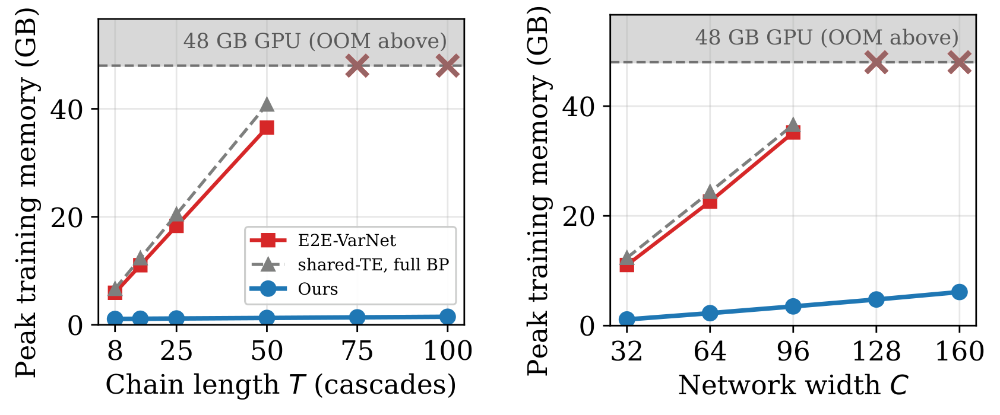

# Scalable Unrolled Chains for MRI Reconstruction

 <br/>
<sub>Peak memory of one training step (batch 1, synthetic 640x372 single-coil input, one RTX A6000
with 48 GB) against chain length T at C=32 (left) and network width C at T=15 (right). "Shared-TE,
full BP" is the shared time-embedded U-Net of our method trained with full backpropagation through
every cascade. Crosses mark configurations that run out of memory.</sub>

The official implementation of [*Scalable Unrolled Chains for MRI Reconstruction*](https://arxiv.org/abs/<ARXIV_ID>).<br/>
*IEEE/CVF Winter Conference on Applications of Computer Vision (WACV) 2027* <br/>
Emiljo Mëhillaj and Ender Konukoglu
<br/>
| [Conference](<CVF_URL>) | [arXiv](https://arxiv.org/abs/<ARXIV_ID>) | [Code](https://github.com/emehillaj/scalable-unrolled-mri) |
<br/>

## Overview

Unrolled networks such as E2E-VarNet are trained by backpropagating through every cascade, so
training memory grows linearly with depth and width. We train one randomly sampled cascade per
optimizer step, with the loss still computed at the output of the full chain. The gradient reaches the
sampled cascade through a backward pass over the later cascades that keeps compact surrogates
(per-channel normalization statistics and 1-bit activation masks) instead of their activations. One
time-conditioned U-Net shared by all cascades keeps the parameter count independent of depth. Peak
memory grows by about 4.5 MB per cascade, against about 730 MB for E2E-VarNet (C=32, figure above).

The code supports fastMRI single-coil knee and multi-coil brain data. Besides our method, it
implements E2E-VarNet (optionally with activation checkpointing), GLEAM and FLAT-style baselines.

## Install

Install torch and torchvision builds that match your GPU and CUDA driver
([pytorch.org](https://pytorch.org)), both from the same index, then the remaining requirements
(Python 3.11 or newer):

```
conda create -n unrolled python=3.13 -y
conda activate unrolled
pip install torch torchvision

git clone https://github.com/emehillaj/scalable-unrolled-mri.git
cd scalable-unrolled-mri
pip install -r requirements.txt
```

## Data

Download the fastMRI knee and brain data as described in
[`local_data/datasets/README.md`](./local_data/datasets/README.md), then set the paths in
[`local_data/constants.py`](./local_data/constants.py) (`PATH_DATASETS`, `PATH_RESULTS`, `PATH_CACHE`).
`--data_path` and `--output_dir` override them per run. The first run indexes the dataset and caches
the index in `PATH_CACHE`, which is slow for brain data on network storage.

## Usage

Run commands from the repository root. The configurations are
`configs/{knee,brain}/{ours,e2e,gleam,flat}.json`.

### Training

```bash
python train.py --config configs/knee/ours.json

# Override values: --chans, --num_cascades, --acceleration, --center_fraction, or any key with --set
python train.py --config configs/brain/ours.json --chans 64 --acceleration 4
python train.py --config configs/knee/e2e.json --set activation_checkpointing=true
```

`--set KEY=VALUE` accepts JSON key-value pairs (as designed in the config file). Each run is written to
`local_data/results/<anatomy>_<method>_<chans>ch_<num_cascades>casc_<acceleration>x/`
(`config.json`, `log.jsonl`, `checkpoint.pt`), for example `knee_ours_32ch_15casc_8x` for the knee
configuration with 32 channels, 15 cascades and 8x acceleration. Use `--output_dir` or
`--set run_name=NAME` to change the location or name.

To resume, repeat the command with `--resume` (optionally followed by a run directory or checkpoint).
Configuration values may be changed when resuming. Paths are not stored in the checkpoint, so pass
`--data_path` again when required.

```bash
python train.py --config configs/knee/ours.json --resume --set learning_rate=1e-5
```

To train on several GPUs, start one process per GPU. The number of GPUs must divide `effective_batch_size` (8 by default).

```bash
torchrun --standalone --nproc_per_node=4 train.py --config configs/brain/ours.json
sbatch scripts/slurm_multigpu.sh --config configs/brain/ours.json   # SLURM
```

### Evaluation

```bash
python evaluate.py --checkpoint local_data/results/knee_ours_32ch_15casc_8x/checkpoint.pt

# Volume-wise metrics, or a different acceleration
python evaluate.py --checkpoint <checkpoint.pt> --volume_metrics
python evaluate.py --checkpoint <checkpoint.pt> --acceleration 4
```

NMSE, PSNR and SSIM are written to `local_data/results/eval/`. Other options: `--weights auto|ema|live`,
`--max_slices N`, `--center_fraction VALUE`, `--snr_threshold VALUE`, `--config PATH`.

The commands used for the paper are in [`local_data/experiments/examples.txt`](./local_data/experiments/examples.txt).

## Repository layout

| Path | Contents |
|---|---|
| `train.py`, `evaluate.py` | Training and evaluation entry points |
| `configs/` | One JSON per method (`ours`, `e2e`, `gleam`, `flat`) for `knee` and `brain` |
| `modeling/` | `sampled_varnet.py` (our SampledVarNet and E2E-VarNet), `activation_light.py` (memory-light autograd functions), `blocks.py` (U-Nets, cascade blocks), `time_unet_variants.py`, `varnet_blocks.py`, `gleam.py`, `flat.py` |
| `data/` | `datasets.py` (SliceDataset builder and masks), `transforms.py`, `samplers.py` (resumable sampler) |
| `training/` | Per-method steps, `losses.py`, `ema.py`, `distributed.py`, `checkpoint.py` |
| `evaluation/` | `metrics.py` (NMSE, PSNR, SSIM), `snr.py` (k-space SNR proxy) |
| `utils/` | Config loading and overrides, seeding, logging, checkpoint I/O |
| `scripts/` | `convert_checkpoint.py`, `profile_memory.py`, `slurm_multigpu.sh` |
| `local_data/` | Paths, dataset instructions, paper commands, README figure |

## Citation

```
@inproceedings{unrolledchains2027,
    author    = {M\"ehillaj, Emiljo and Konukoglu, Ender},
    title     = {Scalable Unrolled Chains for MRI Reconstruction},
    booktitle = {Proceedings of the IEEE/CVF Winter Conference on Applications of Computer Vision (WACV)},
    month     = {<MONTH>},
    pages     = {<PAGES>},
    year      = {2027}
}
```

## Acknowledgements

Built on the [fastMRI](https://github.com/facebookresearch/fastMRI) library and dataset. The adapted
files keep its MIT license notice. The sinusoidal cascade embedding (`modeling/blocks.py`) and the
linear attention of the optional U-Net variants (`modeling/time_unet_variants.py`) follow
[denoising-diffusion-pytorch](https://github.com/lucidrains/denoising-diffusion-pytorch) (MIT).